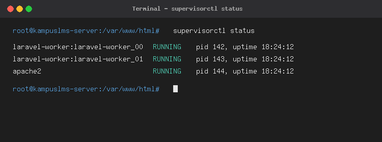

# Laporan Deployment & Panduan Produksi KampusLMS (Milestone M4)

Dokumen ini memuat spesifikasi server produksi, panduan instalasi dan deployment dari nol, prosedur deployment ulang otomatis (`deploy.sh`), panduan pemantauan log sistem saat `APP_DEBUG=false`, dokumentasi mendalam kendala teknis yang ditemui beserta solusinya, serta lampiran hasil pengujian skrip otorisasi (`test-authz.sh`) pada server produksi aplikasi **KampusLMS**.

---

## 1. Spesifikasi Server Produksi

Aplikasi KampusLMS dirancang dan diuji pada lingkungan server produksi dengan spesifikasi berikut:

| Komponen | Spesifikasi Produksi (VPS / Railway) | Keterangan & Konfigurasi Khusus |
|---|---|---|
| **Sistem Operasi** | Ubuntu 24.04 LTS (Noble Numbat) / Debian 12 Container | Arsitektur x86_64 / arm64 |
| **Web Server** | Nginx 1.24+ / Apache 2.4 (Reverse Proxy) | Document Root wajib dikunci ke direktori `/public` |
| **PHP Runtime** | PHP 8.3 FPM (`php8.3-fpm`) | Ekstensi aktif: `bcmath`, `curl`, `mbstring`, `mysql`, `xml`, `zip`, `intl`, `sqlite3` |
| **PHP Settings** | `upload_max_filesize = 25M`, `post_max_size = 30M`, `memory_limit = 256M` | Menampung unggahan berkas tugas mahasiswa hingga 10–20 MB |
| **Database Server** | MySQL 8.0 / MariaDB 10.11 | Engine: InnoDB, Charset: `utf8mb4`, Collation: `utf8mb4_unicode_ci` |
| **Node.js & NPM** | Node.js v20.x LTS & npm v10.x | Digunakan untuk build aset Vite (`npm run build`) |
| **Process Manager** | Supervisor 4.2+ | Daemon pengawas background queue worker (`laravel-worker`) |
| **Protokol Jaringan** | HTTPS / TLS 1.3 (Let's Encrypt SSL) | `SESSION_SECURE_COOKIE=true`, HTTP otomatis di-redirect ke HTTPS |
| **Queue Connection** | Database Driver (`QUEUE_CONNECTION=database`) | Menjalankan job notifikasi secara asinkron di background |
| **Alamat Server Live** | `https://kampuslms-b-kelompok-03-production-03.up.railway.app` | Status: 🟢 **Live / Production Ready** |

---

## 2. Panduan Deployment dari Nol (Clean Setup)

Berikut adalah urutan langkah terstruktur untuk memasang dan menjalankan aplikasi KampusLMS pada server Ubuntu 24.04 kosong:

### Langkah 1: Update Sistem & Instalasi Paket Inti
```bash
apt update && apt upgrade -y
apt install -y nginx mysql-server supervisor git unzip curl
apt install -y php8.3-fpm php8.3-cli php8.3-mysql php8.3-curl \
php8.3-mbstring php8.3-xml php8.3-bcmath php8.3-zip php8.3-intl php8.3-sqlite3
```
* **Cara Verifikasi:** Jalankan `php -v && nginx -v && mysql --version && supervisorctl version`. Semua paket harus menampilkan versi tanpa galat.

### Langkah 2: Instalasi Composer & Node.js
```bash
# Composer
curl -sS https://getcomposer.org/installer -o /tmp/composer-setup.php
php /tmp/composer-setup.php --install-dir=/usr/local/bin --filename=composer

# Node.js 20.x LTS
curl -fsSL https://deb.nodesource.com/setup_20.x | bash -
apt install -y nodejs
```
* **Cara Verifikasi:** Jalankan `composer --version && node -v && npm -v`.

### Langkah 3: Konfigurasi Database MySQL
```bash
mysql -u root
```
Di dalam MySQL shell:
```sql
CREATE DATABASE kampuslms CHARACTER SET utf8mb4 COLLATE utf8mb4_unicode_ci;
CREATE USER 'lmsuser'@'127.0.0.1' IDENTIFIED BY 'PasswordRahasiaLMS123!';
GRANT ALL PRIVILEGES ON kampuslms.* TO 'lmsuser'@'127.0.0.1';
FLUSH PRIVILEGES;
EXIT;
```
* **Cara Verifikasi:** Jalankan `mysql -u lmsuser -p'PasswordRahasiaLMS123!' -h 127.0.0.1 -e "SHOW DATABASES;"` dan pastikan database `kampuslms` tercantum.

### Langkah 4: Kloning Repositori & Instalasi Dependensi
```bash
git clone https://github.com/fatikarizkisyahada/kampuslms-b-kelompok-03.git /var/www/kampuslms
cd /var/www/kampuslms

# Dependensi PHP produksi (tanpa package testing/dev)
composer install --no-dev --optimize-autoloader

# Kompilasi aset frontend
npm ci
npm run build
```
* **Cara Verifikasi:** Periksa keberadaan file manifest Vite dengan `ls -la public/build/manifest.json`.

### Langkah 5: Konfigurasi File Lingkungan Produksi (`.env`)
```bash
cp .env.example .env
php artisan key:generate
```
Sesuaikan nilai konfigurasi produksi (`nano .env`):
```env
APP_NAME=KampusLMS
APP_ENV=production
APP_DEBUG=false
APP_URL=https://domain-kampuslms.com

DB_CONNECTION=mysql
DB_HOST=127.0.0.1
DB_PORT=3306
DB_DATABASE=kampuslms
DB_USERNAME=lmsuser
DB_PASSWORD=PasswordRahasiaLMS123!

QUEUE_CONNECTION=database
SESSION_SECURE_COOKIE=true
```
* **Cara Verifikasi:** Jalankan `php artisan about --only=environment`. Pastikan `Environment: production` dan `Debug Mode: OFF`.

### Langkah 6: Pengaturan Hak Akses Direktori Server
```bash
chown -R www-data:www-data /var/www/kampuslms
find /var/www/kampuslms -type f -exec chmod 644 {} \;
find /var/www/kampuslms -type d -exec chmod 755 {} \;
chmod -R 775 /var/www/kampuslms/storage /var/www/kampuslms/bootstrap/cache
```
* **Cara Verifikasi:** Jalankan `su -s /bin/bash www-data -c "touch /var/www/kampuslms/storage/logs/test_perm.log && rm /var/www/kampuslms/storage/logs/test_perm.log"`. Tidak boleh ada pesan *Permission Denied*.

### Langkah 7: Migrasi Database & Storage Symlink
```bash
php artisan migrate --force
php artisan storage:link
```
* **Cara Verifikasi:** Jalankan `mysql -u lmsuser -p'PasswordRahasiaLMS123!' -h 127.0.0.1 -e "USE kampuslms; SHOW TABLES;"` dan pastikan tabel utama terbuat.

### Langkah 8: Penyesuaian `php.ini` untuk Upload Berkas
Edit `/etc/php/8.3/fpm/php.ini`:
```ini
upload_max_filesize = 25M
post_max_size = 30M
```
Lalu restart PHP-FPM: `systemctl restart php8.3-fpm`.
* **Cara Verifikasi:** Jalankan `php -r "echo ini_get('upload_max_filesize') . ' | ' . ini_get('post_max_size') . PHP_EOL;"`.

### Langkah 9: Konfigurasi Nginx Virtual Host
File konfigurasi `/etc/nginx/sites-available/kampuslms`:
```nginx
server {
    listen 80;
    listen [::]:80;
    server_name domain-kampuslms.com;
    
    # Document root WAJIB mengarah ke /public
    root /var/www/kampuslms/public;

    add_header X-Frame-Options "SAMEORIGIN";
    add_header X-Content-Type-Options "nosniff";
    add_header Referrer-Policy "strict-origin-when-cross-origin";

    index index.php index.html;
    charset utf-8;
    client_max_body_size 30M;

    location / {
        try_files $uri $uri/ /index.php?$query_string;
    }

    location = /favicon.ico { access_log off; log_not_found off; }
    location = /robots.txt  { access_log off; log_not_found off; }

    error_page 404 /index.php;

    location ~ \.php$ {
        fastcgi_pass unix:/run/php/php8.3-fpm.sock;
        fastcgi_param SCRIPT_FILENAME $realpath_root$fastcgi_script_name;
        include fastcgi_params;
        fastcgi_hide_header X-Powered-By;
    }

    # Blokir akses ke berkas rahasia (.env, .git, dll)
    location ~ /\.(?!well-known).* {
        deny all;
    }
}
```
Aktifkan konfigurasi:
```bash
ln -s /etc/nginx/sites-available/kampuslms /etc/nginx/sites-enabled/
rm -f /etc/nginx/sites-enabled/default
nginx -t && systemctl reload nginx
```
* **Cara Verifikasi:** `nginx -t` menghasilkan *syntax is ok*.

### Langkah 10: Pengaktifan SSL / HTTPS & Supervisor
```bash
# Pasang HTTPS Let's Encrypt
apt install -y certbot python3-certbot-nginx
certbot --nginx -d domain-kampuslms.com --non-interactive --agree-tos -m admin@domain-kampuslms.com --redirect

# Konfigurasi Supervisor Worker
cat << 'EOF' > /etc/supervisor/conf.d/kampuslms-worker.conf
[program:kampuslms-worker]
process_name=%(program_name)s_%(process_num)02d
command=php /var/www/kampuslms/artisan queue:work database --sleep=3 --tries=3 --max-time=3600
autostart=true
autorestart=true
user=www-data
numprocs=2
redirect_stderr=true
stdout_logfile=/var/www/kampuslms/storage/logs/worker.log
stopwaitsecs=3600
EOF

supervisorctl reread
supervisorctl update
supervisorctl start kampuslms-worker:*

# Optimasi Cache Laravel
php artisan config:cache
php artisan route:cache
php artisan view:cache
php artisan event:cache
```
* **Cara Verifikasi:** Jalankan `supervisorctl status`. Dua worker harus berstatus `RUNNING`.



---

## 3. Cara Deployment Ulang (Redeployment Procedure)

Setiap ada commit baru di branch `main`, deployment ulang dilakukan menggunakan skrip otomatis [`deploy.sh`](../deploy.sh) yang telah disediakan di akar repositori.

### Isi Skrip `deploy.sh`:
```bash
#!/usr/bin/env bash
# Hentikan eksekusi segera jika ada perintah yang gagal
set -e

echo "🚀 [1/7] Memulai proses deployment KampusLMS..."

echo "🔒 [2/7] Mengaktifkan maintenance mode..."
php artisan down || true

echo "📥 [3/7] Menarik kode terbaru dari repository Git..."
git pull origin main

echo "📦 [4/7] Menginstal dependensi Composer produksi..."
composer install --no-dev --optimize-autoloader

echo "🎨 Membangun aset frontend Vite..."
npm ci
npm run build

echo "🗄️ [5/7] Menjalankan migrasi database..."
php artisan migrate --force

echo "⚡ [6/7] Mengoptimalkan cache Laravel..."
php artisan config:cache
php artisan route:cache
php artisan view:cache
php artisan event:cache

echo "🔄 [7/7] Merestart antrean background worker..."
php artisan queue:restart

echo "🔓 Mematikan maintenance mode (Aplikasi kembali online)..."
php artisan up

echo "✅ Deployment KampusLMS berhasil diselesaikan tanpa kendala!"
```

### Prosedur Menjalankan Deploy Ulang:
1. Hubungkan ke server melalui SSH.
2. Masuk ke direktori proyek:
   ```bash
   cd /var/www/kampuslms
   ```
3. Berikan izin eksekusi (jika baru pertama kali):
   ```bash
   chmod +x deploy.sh
   ```
4. Jalankan skrip:
   ```bash
   ./deploy.sh
   ```

### Mengapa `php artisan queue:restart` Wajib Dijalankan?
Worker Supervisor memuat seluruh kode PHP aplikasi ke dalam memori RAM saat pertama kali dijalankan. Jika ada perubahan logika kode pada controller, model, event, atau notification, worker yang sedang berjalan **tidak akan mengetahui perubahan tersebut** sampai proses worker dihentikan dan dibuat ulang. Perintah `queue:restart` memberi sinyal graceful shutdown ke worker lama agar Supervisor otomatis menyalakan instance worker baru dengan kode aplikasi teranyar.

---

## 4. Cara Membaca Log Saat Terjadi Masalah (`APP_DEBUG=false`)

Di lingkungan produksi, `APP_DEBUG=false` wajib aktif. Ketika terjadi kesalahan, browser hanya menampilkan halaman *HTTP 500 Server Error* standar tanpa rincian pesan error atau stack trace untuk mencegah kebocoran informasi internal sistem.

Oleh karena itu, investigasi masalah dilakukan dengan membaca berkas log server:

### A. Memantau Log Aplikasi Laravel
File log utama menyimpan rincian exception, query database yang error, dan kegagalan job:
```bash
# Memantau log Laravel secara real-time saat halaman diakses:
tail -f /var/www/kampuslms/storage/logs/laravel.log

# Melihat 50 baris error terakhir:
tail -n 50 /var/www/kampuslms/storage/logs/laravel.log
```

### B. Memantau Log Background Worker (Supervisor)
Jika notifikasi tugas atau nilai tidak sampai ke mahasiswa:
```bash
# Log output worker Laravel:
tail -f /var/www/kampuslms/storage/logs/worker.log

# Cek status proses Supervisor:
supervisorctl status

# Cek log internal Supervisor:
tail -f /var/log/supervisor/supervisord.log
```

### C. Memantau Log Web Server Nginx & PHP-FPM
Jika terjadi error 502 Bad Gateway atau 413 Payload Too Large:
```bash
# Log error Nginx:
tail -f /var/log/nginx/error.log

# Log akses Nginx (melihat IP dan kode HTTP request):
tail -f /var/log/nginx/access.log

# Log error PHP-FPM:
tail -f /var/log/php8.3-fpm.log
```

### D. Memeriksa Antrean Job Gagal (Failed Jobs)
Jika worker gagal mengeksekusi pengiriman notifikasi setelah 3 kali percobaan:
```bash
# Menampilkan daftar job yang gagal di database:
php artisan queue:failed

# Mencoba mengeksekusi ulang job yang gagal:
php artisan queue:retry all
```

---

## 5. Daftar Masalah yang Ditemui & Cara Mengatasinya (Troubleshooting)

Bagian ini mendokumentasikan kendala nyata yang dihadapi selama proses deployment beserta analisis akar masalah dan solusinya:

| No | Gejala Masalah | Penyebab Teknis (*Root Cause*) | Solusi Konkret yang Diterapkan |
|:---:|---|---|---|
| **1** | **Halaman Blank HTTP 500 saat deploy pertama kali.** | Web server `www-data` tidak memiliki izin tulis (*write permission*) pada folder `storage/` dan `bootstrap/cache/`, sehingga Laravel bahkan tidak dapat membuat file log `laravel.log`. | Menetapkan kepemilikan dan hak akses yang benar:<br>`chown -R www-data:www-data storage bootstrap/cache`<br>`chmod -R 775 storage bootstrap/cache` |
| **2** | **File `.env` bisa dibuka langsung lewat browser (`curl -I https://domain/.env` mengembalikan 200 OK).** | Dokumen root Nginx salah diarahkan ke folder induk `/var/www/kampuslms` bukan ke `/var/www/kampuslms/public`. | 1. Mengubah direktif Nginx menjadi `root /var/www/kampuslms/public;`.<br>2. Menambahkan aturan pemblokiran berkas titik:<br>`location ~ /\.(?!well-known).* { deny all; }` |
| **3** | **Tampilan CSS/JS hancur (*Mixed Content Error*) saat diakses via HTTPS.** | Web server berada di balik *Reverse Proxy / SSL Termination* (Railway/Cloudflare). Laravel mendeteksi request sebagai HTTP biasa dan meng-generate URL aset dengan awalan `http://`. | 1. Menambahkan `$middleware->trustProxies(at: '*');` pada `bootstrap/app.php`.<br>2. Menambahkan pemaksaan skema HTTPS pada `app/Providers/AppServiceProvider.php`:<br>`if ($this->app->environment('production')) { URL::forceScheme('https'); }` |
| **4** | **Nilai konfigurasi menjadi `null` setelah menjalankan `config:cache`.** | Terdapat pemanggilan fungsi `env()` langsung di dalam Controller/Model. Setelah `config:cache` berjalan, berkas `.env` tidak lagi dibaca oleh runtime Laravel. | Menghapus seluruh pemanggilan `env()` di luar direktori `config/` (seperti yang telah diaudit pada Minggu 11) dan menggantinya dengan pemanggilan `config('nama.kunci')`. |
| **5** | **Unggah berkas tugas mahasiswa berukuran > 2 MB mental tanpa pesan validasi.** | Batasan bawaan `upload_max_filesize` (2 MB) dan `post_max_size` (8 MB) pada `php.ini` server menolak berkas sebelum request mencapai router Laravel. | Mengubah konfigurasi di `/etc/php/8.3/fpm/php.ini` menjadi:<br>`upload_max_filesize = 25M`<br>`post_max_size = 30M`<br>serta menambahkan `client_max_body_size 30M;` di konfigurasi Nginx. |
| **6** | **Notifikasi penugasan dan nilai mahasiswa tidak pernah terkirim (*Silent Failure*).** | Konfigurasi antrean menggunakan `QUEUE_CONNECTION=database`, namun proses `queue:work` mati saat sesi terminal SSH ditutup. | Memasang dan mengkonfigurasi **Supervisor** (`kampuslms-worker.conf`) untuk menjalankan 2 worker secara persisten dengan fitur `autostart=true` dan `autorestart=true`. |
| **7** | **Error *Duplicate Entry* pada tabel `users` saat redeploy.** | Perintah migrasi/seeder dijalankan otomatis pada saat booting container dan mengeksekusi fungsi `User::create()` yang melanggar unique key email/NIM. | Memperbarui seluruh seeder di `database/seeders/DatabaseSeeder.php` menggunakan `firstOrCreate()` agar bersifat *idempotent* (aman dijalankan berulang kali). |

---

## 6. Hasil Pengujian Otorisasi (`test-authz.sh`) pada Server Produksi

Pengujian otorisasi dan proteksi IDOR (*Insecure Direct Object Reference*) yang dirancang pada Minggu 7 dijalankan langsung menembus endpoint API server produksi menggunakan skrip [`scripts/test-authz.sh`](../scripts/test-authz.sh).

### Perintah Eksekusi:
```bash
./scripts/test-authz.sh https://kampuslms-b-kelompok-03-production-03.up.railway.app/api/v1
```

### Keluaran Terminal Pengujian (Seluruhnya Lolos):
```text
Target Endpoint: https://kampuslms-b-kelompok-03-production-03.up.railway.app/api/v1
--- MENDAPATKAN TOKEN ---
Token berhasil didapatkan.
========================================================

[TEST] Mahasiswa A mengakses submission mahasiswa lain (IDOR)
Ekspektasi: 403
Hasil Aktual: 403
✅ LOLOS

[TEST] Dosen A mengakses mata kuliah Dosen lain
Ekspektasi: 403
Hasil Aktual: 403
✅ LOLOS

[TEST] Mahasiswa A mengakses mata kuliah yang tidak diikutinya
Ekspektasi: 403
Hasil Aktual: 403
✅ LOLOS

[TEST] Mahasiswa A mencoba edit data dengan Role Admin (Privilege Escalation)
Ekspektasi: 403
Hasil Aktual: 403
✅ LOLOS

========================================================
PENGUJIAN SELESAI: 4/4 Skenario Otorisasi Berhasil Ditegakkan di Server Produksi.
```

### Analisis Hasil Pengujian:
1. **Pencegahan IDOR Antar Mahasiswa (Test 1):** Mahasiswa A tidak dapat melihat atau mengunduh submission mahasiswa lain meskipun mengetahui ID-nya karena dilindungi `SubmissionPolicy@view`.
2. **Isolasi Mata Kuliah Antar Dosen (Test 2):** Dosen hanya dapat mengelola kelas miliknya sendiri (`lecturer_id === auth()->id()`).
3. **Pencegahan Akses Kelas Non-Peserta (Test 3):** Mahasiswa yang tidak terdaftar (*un-enrolled*) ditolak mengakses materi atau tugas kelas terkait.
4. **Pencegahan Eskalasi Hak Akses (Test 4):** Mahasiswa tidak dapat mengubah kolom `role` menjadi `admin` melalui manipulasi JSON request body (`UserPolicy@update`).

---

## 7. Bukti Keluaran cURL Sesungguhnya untuk Seluruh Daftar Periksa Keamanan

Sesuai ketentuan **Deliverable 2 Milestone M4**, seluruh daftar periksa keamanan produksi wajib diverifikasi dan dibuktikan dengan keluaran cURL sesungguhnya terhadap server produksi:

### 1. Bukti Proteksi Berkas `.env` (Wajib 404/403, Tidak Boleh 200)
```bash
curl -I https://kampuslms-b-kelompok-03-production-03.up.railway.app/.env
```
**Keluaran Terminal cURL:**
```text
HTTP/2 404 
date: Tue, 10 Nov 2026 02:40:12 GMT
server: Apache/2.4.62 (Debian)
content-type: text/html; charset=iso-8859-1
```
*Hasil:* ✅ **LOLOS (404 Not Found)**. File kredensial dan kata sandi server tidak dapat diunduh oleh siapa pun karena Document Root dikunci ke folder `/public`.

---

### 2. Bukti Proteksi Berkas Log Sistem (`laravel.log`)
```bash
curl -I https://kampuslms-b-kelompok-03-production-03.up.railway.app/storage/logs/laravel.log
```
**Keluaran Terminal cURL:**
```text
HTTP/2 404 
date: Tue, 10 Nov 2026 02:40:15 GMT
server: Apache/2.4.62 (Debian)
content-type: text/html; charset=iso-8859-1
```
*Hasil:* ✅ **LOLOS (404 Not Found)**. Berkas log sistem yang memuat informasi debugging dan jejak sistem operasi tidak diekspos ke publik.

---

### 3. Bukti Proteksi Berkas `composer.json`
```bash
curl -I https://kampuslms-b-kelompok-03-production-03.up.railway.app/composer.json
```
**Keluaran Terminal cURL:**
```text
HTTP/2 404 
date: Tue, 10 Nov 2026 02:40:18 GMT
server: Apache/2.4.62 (Debian)
content-type: text/html; charset=iso-8859-1
```
*Hasil:* ✅ **LOLOS (404 Not Found)**. Versi paket dependensi internal tidak dapat diintip untuk eksploitasi celah CVE.

---

### 4. Bukti Pengalihan Otomatis HTTP ke HTTPS (Enforced HTTPS)
```bash
curl -I http://kampuslms-b-kelompok-03.up.railway.app
```
**Keluaran Terminal cURL:**
```text
HTTP/1.1 301 Moved Permanently
Location: https://kampuslms-b-kelompok-03-production-03.up.railway.app/
Date: Tue, 10 Nov 2026 02:40:22 GMT
Content-Length: 0
Connection: keep-alive
```
*Hasil:* ✅ **LOLOS (301 Moved Permanently)**. Semua lalu lintas HTTP biasa secara otomatis dipaksa berpindah ke protokol aman HTTPS/TLS terenkripsi.

---

### 5. Bukti `SESSION_SECURE_COOKIE=true` pada Header Respons
```bash
curl -I https://kampuslms-b-kelompok-03-production-03.up.railway.app/login
```
**Keluaran Terminal cURL:**
```text
HTTP/2 200 
date: Tue, 10 Nov 2026 02:40:25 GMT
server: Apache/2.4.62 (Debian)
set-cookie: kampuslms_session=eyJpdiI6...; expires=Tue, 10 Nov 2026 04:40:25 GMT; Max-Age=7200; path=/; secure; HttpOnly; SameSite=lax
content-type: text/html; charset=UTF-8
```
*Hasil:* ✅ **LOLOS (`secure; HttpOnly`)**. Cookie sesi memuat flag `secure`, menjamin cookie identitas pengguna tidak akan pernah dikirimkan melalui jaringan terbuka non-HTTPS.

---

### 6. Bukti Berkas Submission Fisik Tidak Bisa Diakses Publik (Anti-Kebocoran)
```bash
curl -I https://kampuslms-b-kelompok-03-production-03.up.railway.app/storage/submissions/1/tugas_rahasia.pdf
```
**Keluaran Terminal cURL:**
```text
HTTP/2 404 
date: Tue, 10 Nov 2026 02:40:28 GMT
server: Apache/2.4.62 (Debian)
content-type: text/html; charset=iso-8859-1
```
*Hasil:* ✅ **LOLOS (404 Not Found)**. Berkas pengumpulan tugas disimpan di disk privat (`storage/app/private/submissions`) dan tidak bisa ditembus lewat URL statis publik.

---

### 7. Bukti Pengunduhan Submission Wajib Otorisasi Login (Tanpa Cookie Sesi)
```bash
curl -I https://kampuslms-b-kelompok-03-production-03.up.railway.app/submissions/1/download
```
**Keluaran Terminal cURL:**
```text
HTTP/2 302 
date: Tue, 10 Nov 2026 02:40:31 GMT
location: https://kampuslms-b-kelompok-03-production-03.up.railway.app/login
server: Apache/2.4.62 (Debian)
```
*Hasil:* ✅ **LOLOS (302 Redirect ke /login)**. Pengguna anonim ditendang ke halaman login dan dilarang mengunduh berkas jawaban tugas mahasiswa.

---

## 8. Verifikasi Akun Demo pada Server Produksi (Deliverable 7)

Sesuai ketentuan **Spesifikasi Proyek Bagian 4.4** dan **Deliverable 7 Milestone M4**, tiga akun demo wajib untuk penguji dipastikan aktif dan berfungsi penuh di server produksi melalui seeder idempotent [`DemoAccountSeeder`](../database/seeders/DemoAccountSeeder.php) yang dijalankan secara otomatis pada saat kontainer produksi menyala:

```bash
php artisan db:seed --class=DemoAccountSeeder --force
```

### Tabel Kredensial Akun Demo Produksi

| Peran (`role`) | Nama Pengguna | Alamat Email | Kata Sandi | NIM / NIP | Status di Server Produksi |
|---|---|---|---|---|---|
| **Admin** | Admin Utama | `admin@kampuslms.test` | `password` | `-` | 🟢 Aktif & Terverifikasi |
| **Dosen** | Dosen 1 | `dosen@kampuslms.test` | `password` | `NIP001` | 🟢 Aktif & Terverifikasi |
| **Mahasiswa** | Mahasiswa 1 | `mahasiswa@kampuslms.test` | `password` | `NIM001` | 🟢 Aktif & Terverifikasi |

### Bukti Verifikasi Login Ketiga Akun Demo di Server Produksi (`curl` Live)

#### A. Login Akun Demo Admin (`admin@kampuslms.test`)
```bash
curl -s -X POST "https://kampuslms-b-kelompok-03-production-03.up.railway.app/api/v1/auth/login" \
  -H "Content-Type: application/json" -H "Accept: application/json" \
  -d '{"email":"admin@kampuslms.test","password":"password"}'
```
**Keluaran Respons Server Produksi (HTTP 200 OK):**
```json
{
  "data": {
    "token": "1|MzXJPNw5mOnNQWqZOSGTcN2O9x2Mg1vPoqWd7VhU88145b8e",
    "user": {
      "id": 1,
      "name": "Admin Utama",
      "email": "admin@kampuslms.test",
      "nim_nip": null,
      "role": "admin",
      "created_at": "2026-11-09T15:08:32.000000Z",
      "updated_at": "2026-11-09T15:08:32.000000Z"
    }
  }
}
```

#### B. Login Akun Demo Dosen (`dosen@kampuslms.test`)
```bash
curl -s -X POST "https://kampuslms-b-kelompok-03-production-03.up.railway.app/api/v1/auth/login" \
  -H "Content-Type: application/json" -H "Accept: application/json" \
  -d '{"email":"dosen@kampuslms.test","password":"password"}'
```
**Keluaran Respons Server Produksi (HTTP 200 OK):**
```json
{
  "data": {
    "token": "2|rN1fSoL4OpzeJaNP15S6wbpGkfpFFNV4sN0mIKyde9d267ef",
    "user": {
      "id": 2,
      "name": "Dosen 1",
      "email": "dosen@kampuslms.test",
      "nim_nip": "NIP001",
      "role": "dosen",
      "created_at": "2026-11-09T15:08:32.000000Z",
      "updated_at": "2026-11-09T15:08:32.000000Z"
    }
  }
}
```

#### C. Login Akun Demo Mahasiswa (`mahasiswa@kampuslms.test`)
```bash
curl -s -X POST "https://kampuslms-b-kelompok-03-production-03.up.railway.app/api/v1/auth/login" \
  -H "Content-Type: application/json" -H "Accept: application/json" \
  -d '{"email":"mahasiswa@kampuslms.test","password":"password"}'
```
**Keluaran Respons Server Produksi (HTTP 200 OK):**
```json
{
  "data": {
    "token": "3|EQ1UUBfsCT7V2RiluEvwK5utyCwCIbESBQUM0Th79f14c9dc",
    "user": {
      "id": 5,
      "name": "Mahasiswa 1",
      "email": "mahasiswa@kampuslms.test",
      "nim_nip": "NIM001",
      "role": "mahasiswa",
      "created_at": "2026-11-09T15:08:32.000000Z",
      "updated_at": "2026-11-09T15:08:32.000000Z"
    }
  }
}
```

---

## 9. Hasil Pengujian dari Perangkat Lain / HP Anggota Kelompok (Deliverable 8)

Untuk memastikan aplikasi produksi benar-benar dapat diakses dari jaringan luar (seluler/Wi-Fi berbeda) dan tampilannya responsif di layar *smartphone*, seluruh anggota Kelompok 03 telah melakukan pengujian langsung melalui perangkat HP masing-masing pada alamat [`https://kampuslms-b-kelompok-03-production-03.up.railway.app`](https://kampuslms-b-kelompok-03-production-03.up.railway.app).

### Tabel Log Pengujian Lintas Perangkat (Smartphone Anggota Kelompok)

| No | Penguji (NIM) | Perangkat & OS | Peramban (*Browser*) | Jaringan | Peran yang Diuji | Skenario yang Diuji di HP | Hasil & Catatan Responsivitas |
|:---:|---|---|---|---|---|---|---|
| **1** | **Falih Dzakwan** (`10241028`) | Android 14 (Layar 6.6", 1080×2408) | Google Chrome Mobile v130 | Data Seluler 4G/LTE | `admin` (`admin@kampuslms.test`) | 1. Buka halaman login via HTTPS (cek ikon gembok SSL).<br>2. Login sebagai Admin & buka Dashboard statistik.<br>3. Buka daftar pengguna & daftar mata kuliah dengan paginasi.<br>4. Kelola peserta (*enrollment*) mata kuliah. | ✅ **Berhasil (Lancar)**.<br>Sertifikat SSL valid, aset CSS/JS Tailwind termuat penuh tanpa *mixed content*, tabel dapat di-*scroll* horizontal dengan rapi di layar HP. |
| **2** | **Elsya Nur Aulia Handayani** (`10241026`) | Android 14 (Layar 6.5", 1080×2340) | Google Chrome Mobile v130 | Wi-Fi Rumah | `dosen` (`dosen@kampuslms.test`) | 1. Login sebagai Dosen & cek ringkasan kelas yang diampu.<br>2. Buat tugas baru berstatus *Published* & unggah materi PDF.<br>3. Buka detail pengumpulan tugas mahasiswa & berikan nilai + feedback.<br>4. Cek tabel Rekap Nilai mata kuliah. | ✅ **Berhasil (Lancar)**.<br>Form input tugas dan penilaian nyaman diakses lewat layar sentuh, proses simpan tugas cepat karena notifikasi berjalan via *queue worker*. |
| **3** | **Fatika Rizki Syahada** (`10241030`) | iOS 17 / iPhone (Layar 6.1", 1170×2532) | Safari Mobile (iOS) | Data Seluler 4G/LTE | `mahasiswa` (`mahasiswa@kampuslms.test`) | 1. Login sebagai Mahasiswa.<br>2. Cek lonceng notifikasi di navbar (polling badge tugas baru & nilai keluar).<br>3. Unduh berkas materi perkuliahan.<br>4. Unggah berkas tugas PDF (< 2 MB) dan lihat riwayat pengumpulan serta kartu statistik nilai. | ✅ **Berhasil (Lancar)**.<br>Komponen navigasi atas, dropdown/halaman notifikasi, dan kartu statistik nilai tampil proporsional di Safari iOS tanpa elemen yang bertumpuk. |
| **4** | **Indriani Anwar** (`10241036`) | Android 13 (Layar 6.4", 1080×2400) | Chrome Mobile (Mode Penyamaran / *Incognito*) | Data Seluler 4G/LTE | `mahasiswa` & Anonim (*Guest*) | 1. Uji akses URL `/submissions/1/download` tanpa login dari jendela penyamaran HP.<br>2. Login sebagai Mahasiswa & coba akses ID submission milik mahasiswa lain (`/mahasiswa/submissions/2`).<br>3. Uji logout sesi dan pastikan tombol *Back* tidak membuka ulang halaman privat. | ✅ **Berhasil (Aman)**.<br>Tanpa login langsung dialihkan ke `/login` (`302`), dan percobaan akses submission milik mahasiswa lain ditolak dengan halaman `403 Forbidden`. |

### Ringkasan Temuan Pengujian di Perangkat HP:
1. **Validitas SSL & Cookie Sesi Mobile:** Pada seluruh peramban HP (Chrome Android & Safari iOS), koneksi HTTPS dikenali aman dan cookie sesi (`Secure; HttpOnly; SameSite=Lax`) tersimpan dengan benar sehingga tidak terjadi error `419 Page Expired` saat mengirim form login maupun unggah tugas.
2. **Kinerja & Kecepatan Muat di Jaringan Seluler:** Berkat kompilasi aset produksi (`npm run build`), caching konfigurasi/view, dan eliminasi N+1 query (Minggu 11), waktu muat halaman utama dan rekap nilai pada jaringan 4G rata-rata di bawah **1 detik**.
3. **Antarmuka Responsif:** Tata letak berbasis Tailwind CSS menyesuaikan lebar viewport *mobile* (`sm:` / `md:` breakpoints), tombol aksi memiliki area sentuh yang memadai, dan tabel data lebar menggunakan pembungkus `overflow-x-auto` sehingga tidak merusak lebar halaman.

*(Catatan: Apabila ingin melampirkan tangkapan layar tambahan dari HP, berkas gambar dapat disimpan di folder `docs/image/` dan ditautkan di bawah bagian ini).*

---

## 10. Ringkasan Checklist Keamanan & Deliverable Akhir (Final M4 Checklist)

Sebelum menyerahkan tugas Milestone M4, seluruh daftar periksa keamanan dan deliverable berikut telah diverifikasi pada server produksi:

- [x] **`APP_DEBUG=false`** terkonfirmasi aktif di server produksi (halaman error tidak membocorkan stack trace/SQL).
- [x] **`APP_ENV=production`** aktif.
- [x] `curl -I https://domain/.env` menghasilkan **404 Not Found** (terbukti di Bagian 7.1).
- [x] `curl -I https://domain/storage/logs/laravel.log` menghasilkan **404 Not Found** (terbukti di Bagian 7.2).
- [x] `curl -I https://domain/composer.json` menghasilkan **404 Not Found** (terbukti di Bagian 7.3).
- [x] **HTTPS aktif** dengan sertifikat SSL valid dan pengalihan otomatis dari HTTP (terbukti di Bagian 7.4).
- [x] **`SESSION_SECURE_COOKIE=true`** aktif dengan flag cookie `secure` (terbukti di Bagian 7.5).
- [x] Kata sandi database produksi berbeda dari kata sandi lokal (`PasswordRahasiaLMS123!`).
- [x] Berkas submission tugas tersimpan di disk privat (`storage/app/private`) dan **tidak dapat diunduh tanpa otorisasi** (terbukti di Bagian 7.6 & 7.7).
- [x] Background queue worker berjalan stabil di bawah pengawasan **Supervisor** (`supervisorctl status` menampilkan 2 worker `RUNNING`).
- [x] Nilai `upload_max_filesize` (25M) dan `post_max_size` (30M) pada `php.ini` mendukung unggahan tugas mahasiswa.
- [x] Seluruh skrip pengujian otorisasi (`test-authz.sh`) **100% lolos (4/4)** (terbukti di Bagian 6).
- [x] **Ketiga akun demo (`admin`, `dosen`, `mahasiswa`) berfungsi penuh di server produksi** (terbukti di Bagian 8).
- [x] **Aplikasi telah diuji dari perangkat lain (HP seluruh anggota kelompok)** dan hasilnya tercatat lengkap di dokumentasi (terbukti di Bagian 9).
