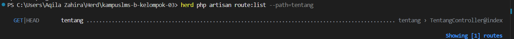

#### Nama : Falih Dzakwan
#### NIM  : 10241028
#### WEEK 2

READ

1. Baris mana di routes/web.php yang menangkapnya?

    Yang menangkapnya berada di baris 12 berikut 
```php
Route::get('/tentang', [TentangController::class, 'index'])
    ->name('tentang');
```
2. Kalau ditangani controller, berkas dan method mana?

    Ada di dalam file app/Http/Controlles/TentangController.php
berikut methodnya:
```php
    public function index()
    {
        return view('tentang');
    }
```

3. View mana yang dikembalikan? Di path apa persisnya?

    Viewnya akan dikembalikan ke file yang ada di resources/views/tentang.blade.php

4. Layout apa yang membungkusnya?

    Layout yang membukusnya adalah x-layout, dengan viewnya berada di resources/views/components/layout.blade.php
5. Jalankan `php artisan route:list --path=tentang`. Cocok dengan analisis Anda?

Output route:list mengonfirmasi route /tentang memang terdaftar dan aktif. Bagian Action di output TentangController@index sama dengan yang ada di file TentangController.php, method index().

---

## BREAK — Delapan Kerusakan (40 Menit)

| # | Yang Dirusak | Prediksi Sebelum Mencoba | Pesan Error / Dampak Sebenarnya |
|---:|---|---|---|
| **1** | Mengubah `Route::get` menjadi `Route::post` pada route daftar mata kuliah, lalu membukanya di browser. | Browser mengirim HTTP GET, sehingga Laravel menolak karena hanya POST yang terdaftar. | `The GET method is not supported for route courses. Supported methods: POST.` |
| **2** | Mengubah nama view pada `return view(...)` menjadi nama file yang tidak ada. | Laravel gagal menemukan berkas `.blade.php` yang diminta. | `View [...] not found.` |
| **3** | Menghapus `->name('courses.show')`, lalu membuka halaman yang memanggil `route('courses.show', ...)`. | Helper `route()` gagal menyusun URL karena nama route sudah tidak terdaftar. | `Route [courses.show] not defined.` |
| **4** | Menaruh route `/courses/{course}` di atas `/courses/create`, lalu membuka `/courses/create`. | Kata `create` tertangkap sebagai parameter `{course}` dan dicari di database sebagai ID mata kuliah. | Muncul **404 Not Found** (Route Model Binding gagal mencari course dengan ID `create`). |
| **5** | Mengganti `{{ $nama }}` menjadi `{!! $nama !!}` di Blade lalu mengisi `$nama` dengan `<script>alert('XSS')</script>`. | Blade tidak melakukan escaping HTML sehingga tag script dieksekusi langsung di browser. | Muncul pop-up alert di browser yang membuktikan celah keamanan **XSS (*Cross-Site Scripting*)**. |
| **6** | Menghapus directive `@vite(...)` dari layout `components/layout.blade.php`. | Aset CSS Tailwind dan JS tidak termuat ke dalam HTML. | Halaman kehilangan seluruh styling dan tampil polos tanpa CSS. |
| **7** | Menghentikan proses `npm run dev` (saat belum di-build), lalu me-refresh browser. | Laravel tidak dapat tersambung ke Vite dev server dan manifest build belum tersedia. | Styling gagal dimuat atau muncul pesan `Vite manifest not found at: .../public/build/manifest.json`. |
| **8** | Memanggil `route('courses.show')` tanpa menyertakan argumen parameter `$course`. | Laravel membutuhkan nilai `{course}` untuk mengisi segmen wajib URL. | `Missing required parameter for [Route: courses.show] [URI: courses/{course}] [Missing parameter: course].` |

---

## Kesimpulan

Melalui percobaan READ dan BREAK pada Minggu 2 ini, terlihat jelas keterkaitan antara definisi rute (`routes/web.php`), urutan pendaftaran route, helper `route()`, controller, file view Blade beserta layout `x-layout`, dan kompilasi aset `@vite`. Kesalahan kecil pada urutan route, penamaan, atau penggunaan `{!! !!}` tanpa escaping langsung berdampak pada error runtime maupun celah keamanan XSS.
